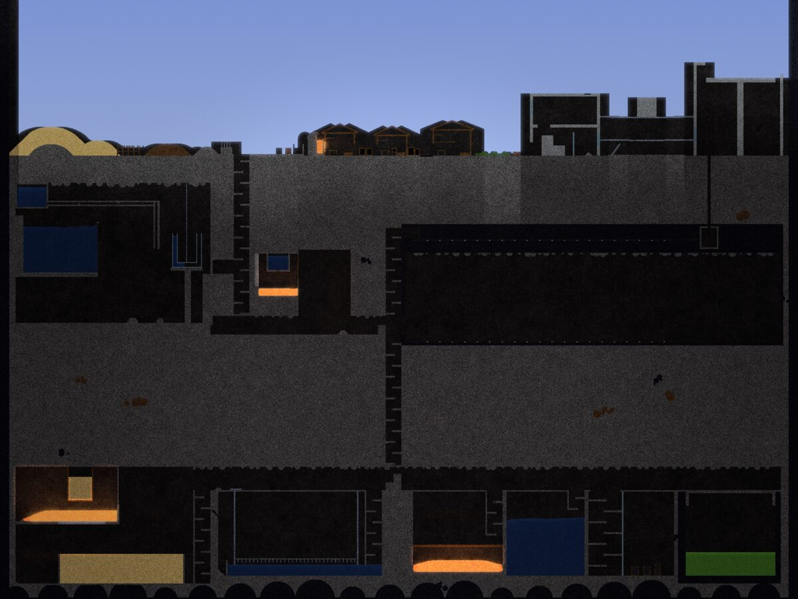
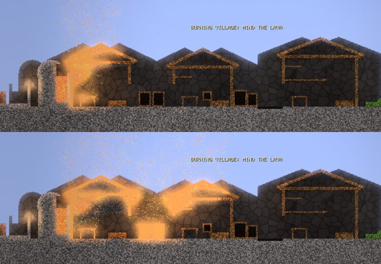
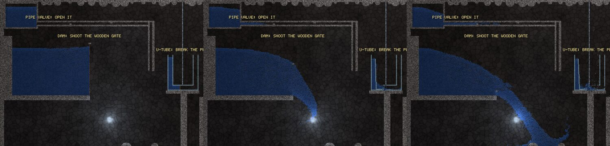
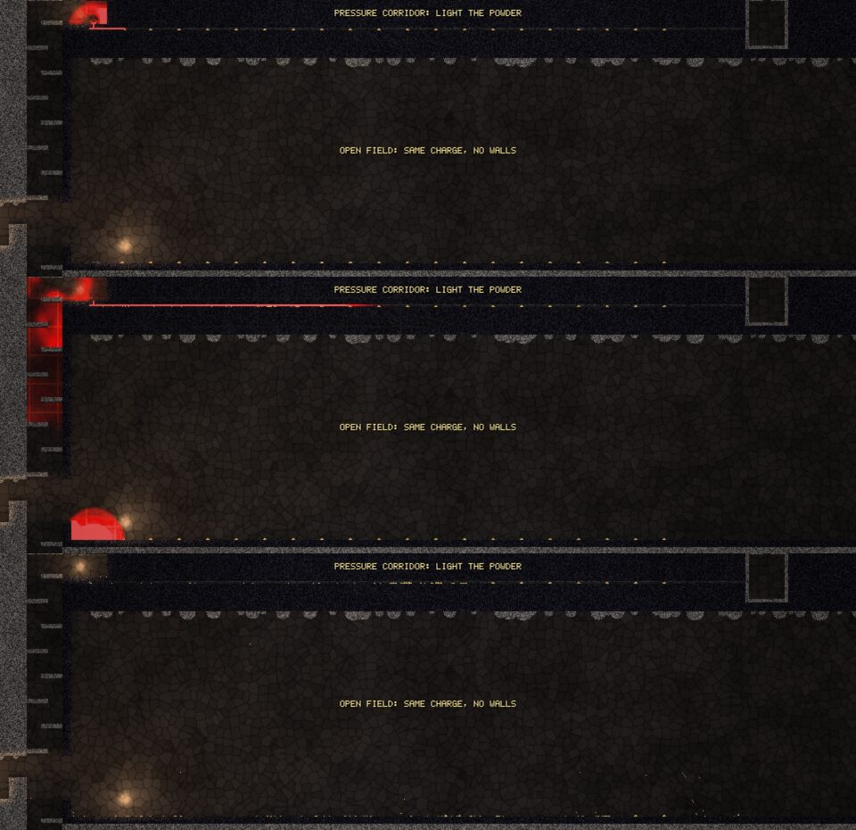
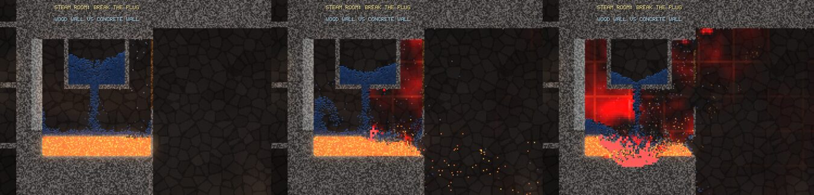
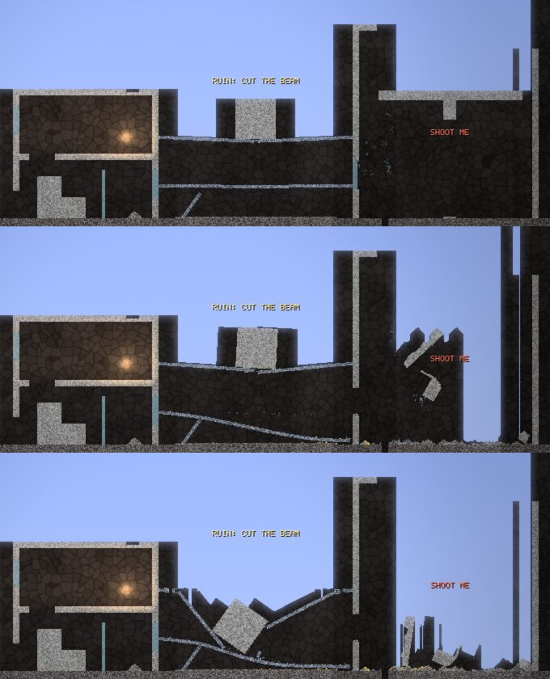
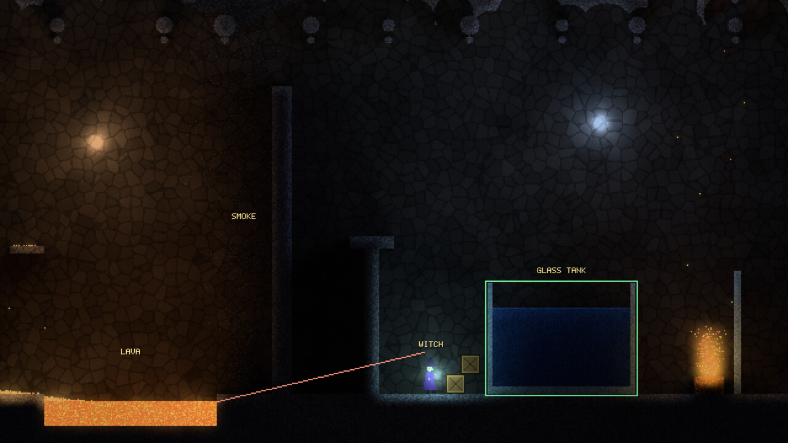

# Hexe

A 2D action game where every pixel is simulated material and pressure is
real. Written in Zig, simulated on the GPU with Vulkan compute.



Hexe follows the falling-sand tradition and adds two kinds of pressure.
Air is a lattice Boltzmann field, so explosions send out waves that bounce
off walls and run down corridors. Water is a FLIP particle fluid with
momentum, so a broken dam floods the room as a wave. Fire, smoke, lava,
acid, steel, glass and rubble all follow the same rules, and enemies will
die to those rules too.

**Status: playable tech demo.** The engine is done and the Proving Grounds
level shows every interaction. The game on top of it is not built yet.

| | |
|---|---|
|  |  |
| A village burns; smoke follows the air field | A wooden dam gives way and the water hits as a wave |
|  |  |
| A charge in a corridor is deadlier than in the open | Water on lava becomes stone and steam that builds pressure |
|  |  |
| Steel beams and concrete become Box2D bodies when cut | Radiance-cascade lighting from lava and fire |

## What works today

- **Pixel grid on the GPU.** Margolus cellular movement, 32×32 activity
  tiles that sleep, and reactions driven by temperature: burning, melting,
  freezing, boiling, corrosion.
- **Materials are data.** 30 materials in [`materials/`](materials) as ZON
  files, hot reloaded while the game runs. [docs/materials.md](docs/materials.md)
  is generated from them.
- **Air.** D2Q9 lattice Boltzmann gas with real pressure waves, buoyancy
  from heat, sealed rooms that build overpressure, and blasts that break
  powders and weak solids by pressure gradient.
- **Water.** FLIP/APIC liquid with a multigrid pressure solve. Still pools
  go to sleep and cost nothing.
- **Rigid bodies.** Box2D v3. Islands cut loose by damage become bodies,
  steel beams sag and snap, slabs fall and shatter.
- **Particles.** Debris, sparks and spray fly ballistically and land back
  in the grid.
- **Lighting.** Radiance cascades from emissive cells, temperature glow,
  and smoke that blocks light.
- **World.** Streamed procedural caves with save and load, plus the
  hand-built Proving Grounds level.
- **A player** who runs, jumps and swims, with ten tools: fire bolt, blast
  charge, water, lava, acid, dig, lightning, cutter, gunpowder and a
  material painter.
- **Testing.** A CPU reference simulation checked bit-for-bit against the
  GPU, headless scenario tests, and benchmarks.

## Still to build

- **Enemies and AI** that run on the CPU readback of the world.
- **A weapon and spell framework**: projectiles, sprays, placed charges and
  beams built as command emitters that carry materials.
- **Damage and status effects**: burning, drowning, crushing, corrosion,
  electrocution; deaths that leave bodies and blood in the sim.
- **Electricity** that flows properly through water and steel. The
  lightning tool exists, but full propagation does not.
- **A vertical slice**: one level where every kind of interaction can kill
  an enemy.
- **Engine extras**: oil floating on water (variable density), simple
  load-bearing for structures, two-way coupling between air and liquid,
  and a magic material class.
- **Windows and macOS support** (see below) and tuning for weaker GPUs.

The full plan is in [docs/05-milestones.md](docs/05-milestones.md). M0–M8
are done; M9, the gameplay layer, is next.

## Build and play

Hexe runs on **Linux only** for now. You need:

- a GPU with a Vulkan 1.3 driver (the target is a 4090-class card; a
  3060-class card is the minimum)
- SDL3
- `glslc` (from shaderc or the Vulkan SDK)
- Zig **0.17.1** (pinned in `.zigversion`)

On Arch:

```bash
sudo pacman -S sdl3 shaderc vulkan-icd-loader
```

Then:

```bash
git clone https://github.com/dackerman/hexe
```

```bash
cd hexe && zig build run -Doptimize=ReleaseFast
```

You start at the hub on the surface of the Proving Grounds. Press **F1**
in the game for the full key list.

| keys | action |
|---|---|
| A / D, Space | move, jump (hold for higher); in water Space swims up and S dives |
| mouse | aim; left button fires the tool, right button its secondary; wheel changes brush size or the painter's material |
| 1–0 | fire bolt, blast charge, water, lava, acid, dig, lightning, cutter / steel beam, gunpowder / wood box, painter |
| Tab | cycle overlays: activity, air pressure, air velocity, liquid particles, bodies, temperature, light |
| R / P / F3 / Esc | reset level / pause / GPU timings / quit |

### Things to try

- Hit the sand dunes with a blast charge.
- Burn the village and watch the smoke follow the wind.
- Shoot the thin wooden dam and the plug in the steam room.
- Set off gunpowder at both ends of the corridor, then in the open field,
  and compare.
- Pour lava on the sand pit to make glass.
- Cut the steel beams in the ruin, then blow out the pillar under the
  watchtower.
- Fire lightning into the pool while the walker is standing in it.
- Pile up gunpowder with tool 9 and light it with a fire bolt.

### Other modes

```bash
zig build run -Doptimize=ReleaseFast -- --sandbox
```

```bash
zig build run -Doptimize=ReleaseFast -- --world --seed 7
```

`--sandbox` is a free paint-and-pan mode. `--world --seed N` is the endless
procedural cave (F5 saves). `--scene proving_grounds_auto --headless
--demo-script shots/demo` renders the scripted showcase to PNGs.

### Windows and macOS

Not supported yet. Zig, SDL3 and Vulkan all work on both, but two pieces of
the code are Linux-specific:

- `src/gpu/context.zig` loads the Vulkan loader as `libvulkan.so.1`. It
  would need `vulkan-1.dll` on Windows and `libvulkan.1.dylib` (MoltenVK)
  on macOS, or it could get the loader from SDL.
- `src/sim/bodies_sim.zig` calls Linux `clock_gettime` directly instead of
  using `std.time`.

With those fixed, Windows with the LunarG Vulkan SDK should be close to
working. macOS is harder: MoltenVK needs the portability-enumeration
extension and may not cover every Vulkan 1.3 feature the compute passes
rely on.

## Tests

```bash
zig build test && zig build verify-determinism && zig build scenarios && zig build bench
```

[docs/08-engineering.md](docs/08-engineering.md) lists every build target.

## Docs

Start with [docs/README.md](docs/README.md). The most useful ones:

- [00-vision.md](docs/00-vision.md): what the game is meant to be
- [01-architecture.md](docs/01-architecture.md): how the simulation fits together
- [04-fluids.md](docs/04-fluids.md): the air and water solvers
- [09-decision-review.md](docs/09-decision-review.md): a review of every
  design decision, readable in one sitting
