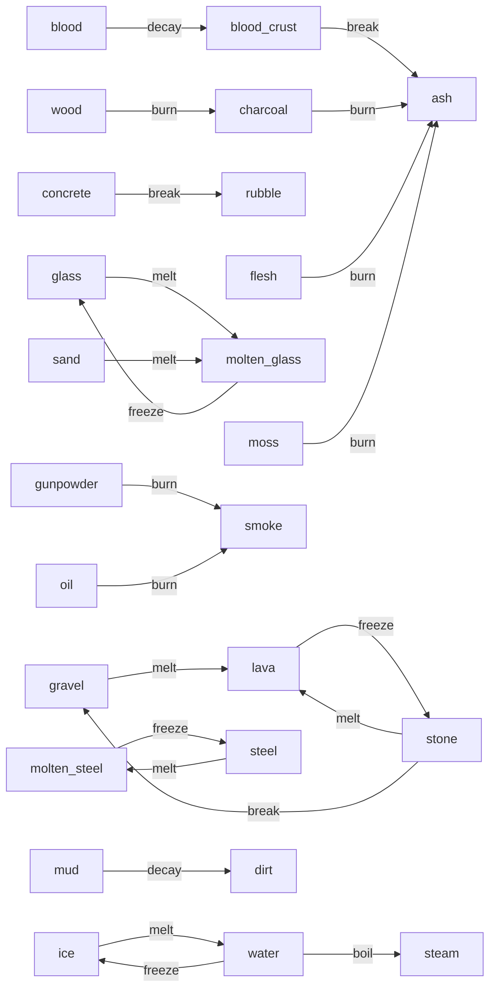

# Materials

<!-- Generated by `zig build docs` (tools/gendocs.zig) from materials/*.zon. Do not edit. -->

Generated from `materials/*.zon`; edit those files and run
`zig build docs`. The schema and the meaning of each field are in
[03-materials.md](03-materials.md). Temperatures are shown in °C as
authored; the GPU stores them as bytes, `°C = 8·t − 40`, rounded to the
nearest step. Melt and boil fire strictly above their threshold, freeze
strictly below it.

## Index

31 materials including built-in air.

| id | name | phase | notes |
|---|---|---|---|
| 0 | air | gas | built in; every empty cell |
| 1 | acid | liquid | Dissolves stone, concrete, steel, wood, flesh and bone; becomes acid gas doing so. |
| 2 | acid_gas | gas | From acid reactions. Corrodes entities. |
| 3 | ash | powder | Byproduct of burning. Light; drifts in air. |
| 4 | bedrock | static | World floor and connectivity anchor. Unbreakable, inert. |
| 5 | blood | liquid | Byproduct of entities. Stains; dries to blood_crust. |
| 6 | blood_crust | static | Dried blood. Chips to ash. |
| 7 | bone | static | Corpse material. Chips; immune to fire; dissolved slowly by acid. |
| 8 | charcoal | static | Hotter, longer fire than wood; burns to ash. |
| 9 | concrete | static | Shatters into rubble; loose chunks fall as bodies. |
| 10 | dirt | powder | Turns to mud with water (reaction lives in water.zon). |
| 11 | flame | gas | Transient energetic gas spawned above burning cells. Emits heat and light. |
| 12 | flesh | static | Corpse material. Burns to ash with smoke; dissolved by acid. |
| 13 | glass | static | Translucent, fragile; raises a pressure event when the blast breaks it. |
| 14 | gravel | powder | Byproduct of stone. Melts back to lava like stone. |
| 15 | gunpowder | powder | Ignites at 200 C; on ignition appends an explode event and becomes smoke. |
| 16 | ice | static | Melts to water above 0 C. Slippery. |
| 17 | lava | liquid | Hot cellular liquid. Emits heat and light; cools to stone below 700 C. |
| 18 | molten_glass | liquid | Cools to glass below 800 C. Emissive. |
| 19 | molten_steel | liquid | Cools to steel below 1300 C. Emissive, conducts. |
| 20 | moss | static | Grows onto stone next to water with low chance. Burns fast to ash. |
| 21 | mud | liquid | Dirt plus water. Slow; dries back to dirt. |
| 22 | oil | liquid | Floats on water; burns to smoke; stains entities. |
| 23 | rubble | powder | Byproduct of concrete. Inert. |
| 24 | sand | powder | Melts to molten glass; turns to molten glass on lava contact. |
| 25 | smoke | gas | From burning. Blocks light; follows the air field. |
| 26 | steam | gas | From boiling water; condenses on cold solids; adds mass to the air field. |
| 27 | steel | static | Conductive, conducts heat fast. Dents and ricochets; immune to blast. |
| 28 | stone | static | Default cave rock. Blasts to gravel, melts to lava. |
| 29 | water | liquid | FLIP-solved liquid. Boils, freezes, conducts, extinguishes, drowns. |
| 30 | wood | static | Burns to charcoal with smoke. Floats as rubble. |

## Static solids

| material | density | health | temp | conductivity | phase changes | flammable | impact | blast | rubble | drag | pressure event | light | flags | ramp |
|---|---|---|---|---|---|---|---|---|---|---|---|---|---|---|
| **bedrock** | 1000 |  |  | 30 |  |  | ricochet | immune |  |  |  |  | anchor | `1c1b22` `26252e` `302e3a` `3a3846` `221f29` |
| **blood_crust** | 100 | 20 |  | 15 |  |  | chip | 10, break | ash | 150 |  |  |  | `3a0c0e` `4a1214` `2e090b` `55181a` |
| **bone** | 180 | 150 | 37 °C | 20 |  |  | chip | 80, break |  | 30 |  |  |  | `d8d0b8` `e6dfc8` `c9bfa4` `f0ead8` |
| **charcoal** | 50 | 60 |  | 15 |  | ignites > 400 °C, 900 ticks → ash, smoke smoke, +40 °C/tick | chip | 60, break |  | 90 |  |  |  | `1e1a18` `2a2420` `352d27` `24201c` `40362e` |
| **concrete** | 280 | 180 |  | 30 |  |  | chip | 150, break | rubble | 20 |  |  |  | `8a8a86` `9a9a95` `7c7c78` `a8a8a2` `6e6e6a` |
| **flesh** | 110 | 60 | 37 °C | 20 |  | ignites > 350 °C, 300 ticks → ash, smoke smoke, +16 °C/tick | chip | 40, break |  | 50 |  |  |  | `b85a52` `c96a60` `a24a44` `d88078` |
| **glass** | 250 | 40 |  | 30 | melts > 1200 °C → molten_glass |  | chip | 30, break |  | 40 | 30 | translucent |  | `a8d8e8` `bce4f0` `94ccdf` `d2eef6` |
| **ice** | 90 | 80 | -10 °C | 60 | melts > 0 °C → water |  | chip | 60, break |  | 40 |  | translucent |  | `b8e2f2` `a4d6ec` `cdeef8` `90c8e2` `e2f6fc` |
| **moss** | 40 | 10 |  | 15 |  | ignites > 250 °C, 40 ticks → ash, smoke smoke, +16 °C/tick | chip | 20, break |  | 150 |  |  |  | `3a5a1e` `4a6e26` `5c8430` `2e4a18` |
| **steel** | 800 | 255 |  | 220 | melts > 1500 °C → molten_steel |  | dent, ricochet | immune |  | 5 |  | glow 500–1500 °C | conductive | `6e7782` `828c98` `5c646e` `98a2ae` `4e555e` |
| **stone** | 300 | 200 |  | 40 | melts > 1300 °C → lava |  | chip | 200, break | gravel | 20 |  | glow 600–1300 °C |  | `5e5a56` `6c6762` `7a746e` `524e4a` `87807a` `45423f` |
| **wood** | 60 | 120 |  | 10 |  | ignites > 300 °C, 600 ticks → charcoal, smoke smoke, +24 °C/tick | chip | 80, break |  | 80 |  |  |  | `6b4423` `7d522c` `5a3a1e` `8f6236` `4e3219` |

## Powders

| material | density | slide | conductivity | phase changes | flammable | impact | blast | drag | ramp |
|---|---|---|---|---|---|---|---|---|---|
| **ash** | 30 | 220 | 10 |  |  | spray | 5, fly | 240 | `5a5652` `6e6a65` `85807a` `9c968f` `4a4744` |
| **dirt** | 140 | 60 | 20 |  |  | spray | 25, fly | 70 | `5b3a1e` `6b4526` `7a5230` `4e321a` `86603a` |
| **gravel** | 160 | 120 | 30 | melts > 1300 °C → lava |  | spray | 40, fly | 30 | `6a6460` `7d7670` `5a5450` `8e8780` `4c4744` |
| **gunpowder** | 120 | 150 | 20 |  | ignites > 200 °C, 1 ticks → smoke, event `explode` | spray | 15, fly | 80 | `2c2c30` `3a3a40` `48484e` `232327` `55555c` |
| **rubble** | 170 | 100 | 25 |  |  | spray | 40, fly | 25 | `7a756e` `8c867e` `66615b` `9e978e` `58534e` |
| **sand** | 150 | 200 | 25 | melts > 1200 °C → molten_glass |  | spray | 20, fly | 60 | `d9b464` `e6c47a` `c9a052` `f0d48e` `bd9446` |

## Liquids

| material | solver | density | dispersion | lifetime | temp | conductivity | emits heat | phase changes | flammable | impact | blast | drag | light | flags | ramp |
|---|---|---|---|---|---|---|---|---|---|---|---|---|---|---|---|
| **acid** |  | 110 | 4 |  |  | 40 |  |  |  | splash | 10, fly | 180 | translucent |  | `3d8b1f` `5cb82a` `7fd93a` `a6f05a` `4fa324` |
| **blood** |  | 105 | 4 | 1800 ticks → blood_crust | 37 °C | 40 |  |  |  | splash | 10, fly | 150 |  |  | `5c0a0e` `7a1016` `8f1820` `6b0d12` |
| **lava** |  | 270 | 1 |  | 1100 °C | 60 | 40 °C/tick | freezes < 700 °C → stone |  | splash | 40, fly | 60 | emissive 200, glow 700–1300 °C |  | `8f1d0a` `c23410` `e8521a` `ff7a24` `ffa63a` `ffd25a` |
| **molten_glass** |  | 240 | 1 |  | 1200 °C | 50 |  | freezes < 800 °C → glass |  | splash | 40, fly | 60 | emissive 160, glow 800–1200 °C |  | `ff9a3a` `ffb855` `ffd27a` `e8782a` |
| **molten_steel** |  | 780 | 1 |  | 1500 °C | 200 |  | freezes < 1300 °C → steel |  | splash | 60, fly | 20 | emissive 200, glow 1000–1500 °C | conductive | `ffc85a` `fff0a0` `ffe07a` `f0a040` |
| **mud** |  | 130 | 1 | 3600 ticks → dirt |  | 30 |  |  |  | splash | 30, fly | 60 |  |  | `3e2a18` `4a3320` `553b26` `34230f` |
| **oil** |  | 80 | 4 |  |  | 20 |  |  | ignites > 250 °C, 400 ticks → smoke, smoke smoke, +24 °C/tick | splash | 10, fly | 150 |  |  | `1a1410` `241c16` `2e241c` `14100c` |
| **water** | flip | 100 | 5 |  |  | 60 |  | boils > 100 °C → steam; freezes < 0 °C → ice |  | splash | 10, fly | 200 | translucent | conductive, extinguishes | `1a3a6b` `215091` `2a66b5` `3a7ad0` `2459a0` |

## Gases

| material | density | dispersion | lifetime | temp | conductivity | emits heat | blast | drag | light | flags | ramp |
|---|---|---|---|---|---|---|---|---|---|---|---|
| **acid_gas** | 9 | 5 | 300 ticks → air |  | 10 |  | immune | 255 | translucent |  | `6b8f3a` `85a84a` `9fc25e` `7a9e44` |
| **flame** | 3 | 2 | 20 ticks → air | 900 °C | 80 | 60 °C/tick | immune | 255 | emissive 255, translucent |  | `ffd23f` `ffa52a` `ff7a1a` `ff4f12` `fff08a` |
| **smoke** | 8 | 4 | 1200 ticks → air |  | 10 |  | immune | 255 | translucent, blocks light |  | `3a3a3c` `4a4a4d` `58585c` `2e2e30` |
| **steam** | 5 | 6 | 600 ticks → air | 110 °C | 20 |  | immune | 255 | translucent | feeds air | `c8d0d8` `d8dee4` `b8c2cc` `e6eaee` |

## Reactions

Each entry is defined once, in one of the two files, and applies to the
pair symmetrically. "—" means unchanged. Chance is per tick per
adjacent pair, out of 255 (255 = always). Temperature bounds apply to
the mean of the two cells' temperatures.

| A | B | A becomes | B becomes | chance | temperature | catalyst | event | defined in |
|---|---|---|---|---|---|---|---|---|
| acid | stone | acid_gas | air | 20 |  |  |  | `acid.zon` |
| acid | concrete | acid_gas | air | 24 |  |  |  | `acid.zon` |
| acid | steel | acid_gas | air | 8 |  |  |  | `acid.zon` |
| acid | wood | acid_gas | air | 30 |  |  |  | `acid.zon` |
| acid | flesh | acid_gas | air | 40 |  |  |  | `acid.zon` |
| acid | bone | acid_gas | air | 4 |  |  |  | `acid.zon` |
| gunpowder | flame | smoke | — | 255 |  |  | explode | `gunpowder.zon` |
| moss | stone | — | moss | 1 |  | water |  | `moss.zon` |
| sand | lava | molten_glass | — | 16 |  |  |  | `sand.zon` |
| steam | stone | water | — | 6 | ≤ 60 °C |  |  | `steam.zon` |
| steam | bedrock | water | — | 6 | ≤ 60 °C |  |  | `steam.zon` |
| steam | concrete | water | — | 6 | ≤ 60 °C |  |  | `steam.zon` |
| steam | steel | water | — | 6 | ≤ 60 °C |  |  | `steam.zon` |
| steam | glass | water | — | 6 | ≤ 60 °C |  |  | `steam.zon` |
| steam | ice | water | — | 6 | ≤ 60 °C |  |  | `steam.zon` |
| water | lava | steam | stone | 255 |  |  |  | `water.zon` |
| water | dirt | mud | mud | 20 |  |  |  | `water.zon` |
| water | flame | steam | air | 60 |  |  |  | `water.zon` |

### Reaction matrix

Rows are the cell, columns its neighbor; each cell of the matrix shows
what the row material becomes (`·` unchanged, `air` consumed). Only
materials that take part in a reaction are listed.

| | acid | bedrock | bone | concrete | dirt | flame | flesh | glass | gunpowder | ice | lava | moss | sand | steam | steel | stone | water | wood |
|---|---|---|---|---|---|---|---|---|---|---|---|---|---|---|---|---|---|---|
| **acid** | | | acid_gas | acid_gas | | | acid_gas | | | | | | | | acid_gas | acid_gas | | acid_gas |
| **bedrock** | | | | | | | | | | | | | | · | | | | |
| **bone** | air | | | | | | | | | | | | | | | | | |
| **concrete** | air | | | | | | | | | | | | | · | | | | |
| **dirt** | | | | | | | | | | | | | | | | | mud | |
| **flame** | | | | | | | | | · | | | | | | | | air | |
| **flesh** | air | | | | | | | | | | | | | | | | | |
| **glass** | | | | | | | | | | | | | | · | | | | |
| **gunpowder** | | | | | | smoke | | | | | | | | | | | | |
| **ice** | | | | | | | | | | | | | | · | | | | |
| **lava** | | | | | | | | | | | | | · | | | | stone | |
| **moss** | | | | | | | | | | | | | | | | · | | |
| **sand** | | | | | | | | | | | molten_glass | | | | | | | |
| **steam** | | water | | water | | | | water | | water | | | | | water | water | | |
| **steel** | air | | | | | | | | | | | | | · | | | | |
| **stone** | air | | | | | | | | | | | moss | | · | | | | |
| **water** | | | | | mud | steam | | | | | steam | | | | | | | |
| **wood** | air | | | | | | | | | | | | | | | | | |

## Entity contact effects

| material | effects |
|---|---|
| acid | corrode 15 hp/s, strip_armor |
| acid_gas | corrode 15 hp/s, strip_armor |
| blood | bloody |
| flame | ignite |
| ice | slippery |
| lava | burn 40 hp/s, ignite |
| molten_glass | burn 30 hp/s, ignite |
| molten_steel | burn 50 hp/s, ignite |
| mud | slow 70% |
| oil | oily, slippery |
| smoke | blind |
| steam | burn 5 hp/s |
| water | slow 50%, drown, buoyant, extinguish, wet |

## Byproduct graph

Derived from melt, freeze, boil, lifetime decay, burning, rubble and
reaction fields. Every arrow is data.

```
acid + stone → acid_gas + air
acid + concrete → acid_gas + air
acid + steel → acid_gas + air
acid + wood → acid_gas + air
acid + flesh → acid_gas + air
acid + bone → acid_gas + air
acid_gas ─decay 300 ticks→ air
blood ─decay 1800 ticks→ blood_crust
blood_crust ─break→ ash
charcoal ─burn→ ash, emits smoke while burning
concrete ─break→ rubble
flame ─decay 20 ticks→ air
flesh ─burn→ ash, emits smoke while burning
glass ─melt >1200°C→ molten_glass
gravel ─melt >1300°C→ lava
gunpowder ─burn→ smoke + explode event
gunpowder + flame → smoke + flame + explode event
ice ─melt >0°C→ water
lava ─freeze <700°C→ stone
molten_glass ─freeze <800°C→ glass
molten_steel ─freeze <1300°C→ steel
moss ─burn→ ash, emits smoke while burning
moss + stone (with water) → moss + moss
mud ─decay 3600 ticks→ dirt
oil ─burn→ smoke, emits smoke while burning
sand ─melt >1200°C→ molten_glass
sand + lava → molten_glass + lava
smoke ─decay 1200 ticks→ air
steam ─decay 600 ticks→ air
steam + stone → water + stone
steam + bedrock → water + bedrock
steam + concrete → water + concrete
steam + steel → water + steel
steam + glass → water + glass
steam + ice → water + ice
steel ─melt >1500°C→ molten_steel
stone ─melt >1300°C→ lava
stone ─break→ gravel
water ─boil >100°C→ steam
water ─freeze <0°C→ ice
water + lava → steam + stone
water + dirt → mud + mud
water + flame → steam + air
wood ─burn→ charcoal, emits smoke while burning
```



## GPU table layout

`MaterialGpu` (src/data/gpu_tables.zig), 176 bytes, 256 entries,
std140- and std430-compatible. Every field is a `uint`; `ramp` is
`uvec4 ramp[2]` holding 8 RGBA8 colors.

| offset | field |
|---|---|
| 0 | `phase` |
| 4 | `density` |
| 8 | `dispersion` |
| 12 | `slide` |
| 16 | `state_init` |
| 20 | `health` |
| 24 | `lifetime` |
| 28 | `lifetime_period` |
| 32 | `decays_to` |
| 36 | `temperature` |
| 40 | `conductivity` |
| 44 | `emits_heat` |
| 48 | `melt_at` |
| 52 | `melt_to` |
| 56 | `freeze_at` |
| 60 | `freeze_to` |
| 64 | `boil_at` |
| 68 | `boil_to` |
| 72 | `ignite_at` |
| 76 | `burn_fuel` |
| 80 | `burn_period` |
| 84 | `burns_to` |
| 88 | `smoke` |
| 92 | `burn_heat` |
| 96 | `burn_event` |
| 100 | `flags` |
| 104 | `impact` |
| 108 | `blast_threshold` |
| 112 | `blast_response` |
| 116 | `rubble` |
| 120 | `drag` |
| 124 | `emissive` |
| 128 | `glow_from` |
| 132 | `glow_to` |
| 136 | `pressure_event` |
| 140 | `ramp_len` |
| 144 | `ramp` |

`ReactionEntry`, 8 bytes, 256 × 256 entries indexed `[self * 256 + neighbor]`
(std430 `uvec2`):

| offset | field |
|---|---|
| 0 | `self_result` |
| 1 | `other_result` |
| 2 | `chance` |
| 3 | `min_temp` |
| 4 | `max_temp` |
| 5 | `catalyst` |
| 6 | `event` |
| 7 | `flags` |
